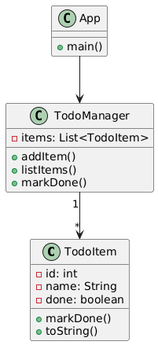

Aplikacja to prosta lista zadań (ToDo), działająca w konsoli.  
Pozwala:
- dodawać zadania,
- oznaczać je jako wykonane,
- wyświetlać wszystkie lub tylko ukończone pozycje.

Całość napisana obiektowo w Javie z użyciem kilku współpracujących klas:
- `TodoItem` – reprezentuje pojedyncze zadanie,
- `TodoManager` – zarządza listą zadań (dodawanie, usuwanie, zmiana statusu),
- `App` – klasa uruchomieniowa (interfejs użytkownika w konsoli).

---

Jak uruchomić aplikację?

1. Otwórz terminal w folderze projektu.
2. Wykonaj polecenie:
   ```bash
   mvn clean package
3. Uruchom aplikację:
   java -cp target/todo-app-1.0-SNAPSHOT.jar com.example.todo.App

